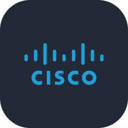
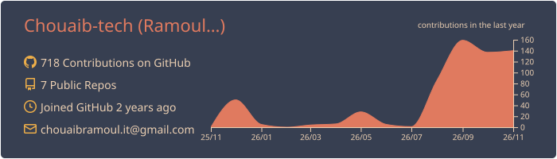
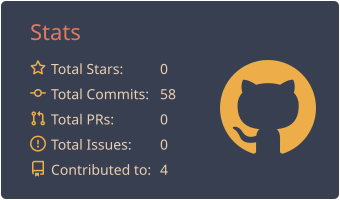
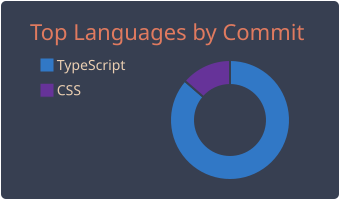

<!-- HEADER -->

  

  

  
  
  
  
  

 

<!-- ABOUT -->
<h2>About Me</h2>

I'm a <b>Full-Stack Developer</b> from Algeria, graduated from Université Badji Mokhtar Annaba.
I build web and mobile products end-to-end — from the interface to the database — with a strong focus on <b>security</b>.

<ul>
  <li><b>Full-Stack Development</b> — React, Next.js, React Native and backend APIs</li>
  <li><b>Cybersecurity</b> — ethical hacking, penetration testing, cryptographic protocols</li>
  <li><b>Automation & Networking</b> — n8n workflows, Cisco Packet Tracer</li>
  <li><b>Problem Solving</b> — turning business needs into clean, working software</li>
  <li><b>Continuous Learning</b> — advanced security techniques and modern web tech</li>
</ul>

<pre><code>const chouaib = {
  role: "Full-Stack Developer",
  location: "Algeria",
  focus: ["Web Apps", "Mobile Apps", "Secure Systems"],
  learning: ["Advanced Pentesting", "Cloud &amp; DevOps"],
  contact: "chouaibramoul.it@gmail.com",
};</code></pre>

 

<!-- TECH STACK -->
<h2>Tech Stack</h2>

<h4>Languages</h4>

  
  
  
  
  
  
  
  
  

<h4>Frameworks & Databases</h4>

  
  
  
  
  
  
  
  

<h4>Security, Networking & Tools</h4>

  
  
  
  
  
  
  
  

<!-- STATS (generated by the profile-cards workflow) -->
<h2>GitHub Activity</h2>

  

  
  

  

<!-- SNAKE -->

  <picture>
    <source media="(prefers-color-scheme: dark)" srcset="https://raw.githubusercontent.com/Chouaib-tech/Chouaib-tech/output/github-snake-dark.svg" />
    
  </picture>

<!-- FOOTER -->

  

